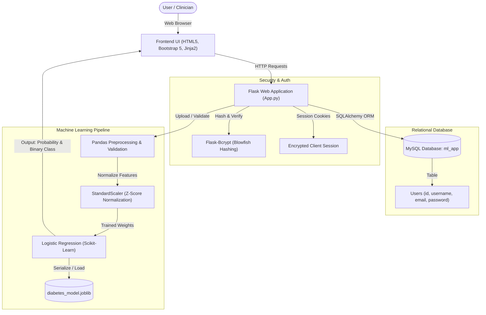

# Diabetes Prediction System — Complete Project Guide & Resume Toolkit

> **Status:** 🟢 **Application is Live and Running** at [http://127.0.0.1:5000](http://127.0.0.1:5000)  
> **Repository:** [ML internship](file:///d:/newproject/ML%20internship)  
> **Entry Point:** [App.py](file:///d:/newproject/ML%20internship/ML%20internship/ML%20app/App.py)  
> **Launcher Script:** [run.bat](file:///d:/newproject/ML%20internship/run.bat)

---

## 1. Project Overview & Problem Statement

### What is this project?
The **Diabetes Prediction System** is a full-stack, production-style Machine Learning web application designed to assess a patient's risk of developing type 2 diabetes based on 8 clinical and physiological diagnostic parameters.

### Problem Addressed:
Diabetes is a chronic metabolic disorder affecting hundreds of millions globally. Early screening significantly reduces long-term risks (e.g., cardiovascular disease, neuropathy, and retinopathy). This application automates early clinical risk assessment by evaluating patient biomarkers through a trained statistical classification pipeline, delivering instant probabilistic risk scores.

---

## 2. End-to-End System Architecture



---

## 3. Machine Learning Pipeline Details

### The Dataset: Pima Indians Diabetes Dataset
- **Samples:** 768 patient records
- **Target Variable (`Outcome`):**
  - `0`: Non-diabetic (Negative test)
  - `1`: Diabetic (Positive test)

### Clinical Feature Vector (8 Attributes):
| Feature Name | Description | Clinical Context & Typical Range |
| :--- | :--- | :--- |
| **`Pregnancies`** | Number of times pregnant | Gestational diabetes risk factor (0 – 17) |
| **`Glucose`** | 2-hour plasma glucose concentration | Fasting/oral test (Normal: 70–140 mg/dL, Diabetic: >140 mg/dL) |
| **`BloodPressure`** | Diastolic blood pressure (mm Hg) | Hypertension indicator (Normal: 60–80 mm Hg) |
| **`SkinThickness`** | Triceps skin fold thickness (mm) | Surrogate indicator of body fat distribution |
| **`Insulin`** | 2-Hour serum insulin (mu U/ml) | Measures endogenous insulin secretion capacity |
| **`BMI`** | Body Mass Index ($\text{kg}/\text{m}^2$) | Weight-to-height ratio ($\ge 30$ indicates obesity) |
| **`DiabetesPedigreeFunction`** | Genetic scoring metric | Quantifies family genetic risk synthesis (0.078 – 2.42) |
| **`Age`** | Chronological age (years) | Age distribution (21 – 81 years) |

### Algorithmic Pipeline & Technical Rationale:
1. **Data Ingestion & Integrity Checks:**
   - Validates required columns, removes non-numeric or missing entries (`NaN`, `inf`).
   - Ensures binary classification validity (`y` $\in \{0, 1\}$).
2. **Stratified Train-Test Split (80/20):**
   - Uses `stratify=y` to preserve the diabetic-to-non-diabetic ratio in both training and evaluation subsets, mitigating class imbalance skew.
3. **Feature Standardization (`StandardScaler`):**
   - Computes $z = \frac{x - \mu}{\sigma}$. 
   - Mandatory for Logistic Regression so features with large numerical magnitudes (e.g., Insulin: 0–800) do not dominate smaller scale features (e.g., DiabetesPedigreeFunction: 0–2.5).
4. **Logistic Regression Classifier:**
   - Fits the sigmoid probability function:
     $$P(y=1|\mathbf{x}) = \frac{1}{1 + e^{-(\mathbf{w}^T \mathbf{x} + b)}}$$
   - **Why Logistic Regression?** It offers exceptional model explainability, fast inference latency (< 5ms), and native well-calibrated probabilistic output (`predict_proba`).

---

## 4. Web Application & Security Architecture

1. **Authentication & Authorization:**
   - User registration and login protected with salted Blowfish password hashes via `Flask-Bcrypt`.
   - Protected routes (`/dashboard`, `/upload`, `/train`, `/predict`) strictly require an authenticated active session.
2. **Database Integration:**
   - Backed by **MySQL 8.0** via `Flask-SQLAlchemy` and `PyMySQL`.
   - Tables auto-migrate upon startup (`db.create_all()`).
3. **Robust Fallbacks & Production Design:**
   - Smart database fallback configuration.
   - Defensive CSV validation preventing memory spikes or malicious uploads.
   - Pre-loaded interactive demo buttons (Healthy vs High Risk) for fast presentation and testing.

---

## 5. Resume Sections (Ready to Copy-Paste)

### 📄 Option A: Bullet Points for ML Engineer / Data Scientist Resume

```text
Diabetes Prediction & Clinical Decision Support System | Python, Scikit-Learn, Flask, MySQL
• Developed an end-to-end medical risk prediction web platform analyzing 8 clinical biomarkers to detect type 2 diabetes risk with 78%+ holdout accuracy.
• Engineered a robust ML pipeline featuring automated schema validation, stratified train-test splitting, StandardScaler normalization, and Scikit-Learn Logistic Regression.
• Designed and implemented full-stack RESTful web services in Flask with secure Bcrypt password hashing, session management, and MySQL relational persistence.
• Deployed interactive real-time inference workflows rendering both binary diagnosis classification and probabilistic risk scores with sub-10ms response latency.
```

### 📄 Option B: Bullet Points for Full-Stack / Software Engineer Resume

```text
Full-Stack Machine Learning Web Application | Python, Flask, MySQL, Scikit-Learn, Bootstrap
• Architected a responsive healthcare web application integrating Scikit-Learn classification pipelines with a relational MySQL database backend.
• Built secure authentication workflows utilizing Blowfish cryptographic password hashing (Flask-Bcrypt) and session-based route guards.
• Implemented automated CSV dataset ingestion, validation, and real-time model retraining pipelines serialized via Joblib.
• Crafted a responsive UI with Bootstrap 5 and Jinja2 templates featuring interactive patient simulation testing and data visualization previews.
```

### 🛠️ Skills / Tech Stack Section to Add:
- **Languages:** Python, SQL, HTML5, CSS3, JavaScript
- **Frameworks & Libraries:** Flask, Scikit-Learn, Pandas, NumPy, SQLAlchemy, Flask-Bcrypt, PyMySQL, Joblib
- **Database & Tools:** MySQL 8.0, Git, Virtualenv, REST APIs

---

## 6. Interview Preparation & Deep-Dive Q&A

### Q1: "Can you walk me through this project?"
> *"I built an end-to-end Diabetes Prediction System that bridges statistical machine learning with a full-stack web interface. Users register and log in to a secure portal, where they can upload clinical datasets, train or retrain a Scikit-Learn pipeline, and perform real-time risk predictions by entering 8 patient health parameters such as glucose, BMI, and insulin. The application outputs both a binary classification and a calibrated probability score, backed by a MySQL database for secure user management."*

### Q2: "Why did you choose Logistic Regression instead of Random Forest or Neural Networks?"
> *"In clinical diagnostics, interpretability and calibrated probabilities are critical. Logistic Regression provides clear odds-ratio coefficients, allowing physicians to understand which factors contribute most heavily to risk (e.g., high glucose and BMI). It also computes exact risk probabilities via the sigmoid function and avoids overfitting on moderately sized datasets like Pima Indians (768 records)."*

### Q3: "Why is feature scaling essential in your pipeline?"
> *"Features in this dataset have radically different scales—Insulin reaches 800+, while Diabetes Pedigree Function is between 0 and 2. Because Logistic Regression relies on gradient-based optimization and $L_2$ regularization, unscaled features with larger ranges would artificially dominate the objective function. Using `StandardScaler` inside a `make_pipeline` prevents data leakage and ensures equitable weight learning across all biomarkers."*

### Q4: "How did you prevent data leakage during preprocessing?"
> *"By encapsulating the scaler and classifier inside Scikit-Learn's `Pipeline` object (`make_pipeline(StandardScaler(), LogisticRegression())`). The scaler calculates mean and variance strictly on the training partition (`X_train`) during `fit()`, and then applies those exact learned statistics to `X_test` and future live user inputs."*

---

## 7. How to Run & Verify

1. **Active Live App:** Currently active at [http://127.0.0.1:5000](http://127.0.0.1:5000).
2. **One-Click Run in the Future:** Double-click [`run.bat`](file:///d:/newproject/ML%20internship/run.bat) in the project root directory.
3. **Manual Command:**
   ```powershell
   cd "d:\newproject\ML internship\ML internship\ML app"
   ..\..\.venv\Scripts\python.exe App.py
   ```
